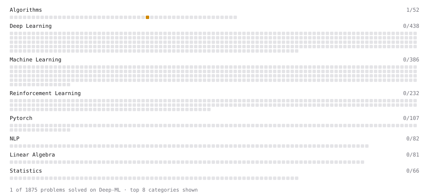

# Deep-ML

My machine learning practice from [Deep-ML](https://www.deep-ml.com). Every solution here was written by hand.

**2** solved · 0 problems · 0 labs · 2 math

[**Browse the interactive portfolio**](https://AATK1331.github.io/deep-ml/) to replay this filling in over time.

## Math

| | Difficulty | Solved | |
| --- | --- | --- | --- |
| [Adjacency, Degree and the Normalized Adjacency Matrix](https://www.deep-ml.com/math-problems/187) | easy | 2026-10-29 | [solution](math/0187-adjacency-degree-and-the-normalized-adjacency-matrix) |
| [Eigendecomposition and SVD](https://www.deep-ml.com/math-problems/16) | hard | 2026-10-31 | [solution](math/0016-eigendecomposition-and-svd) |

---

_This file is regenerated by Deep-ML on every push._
